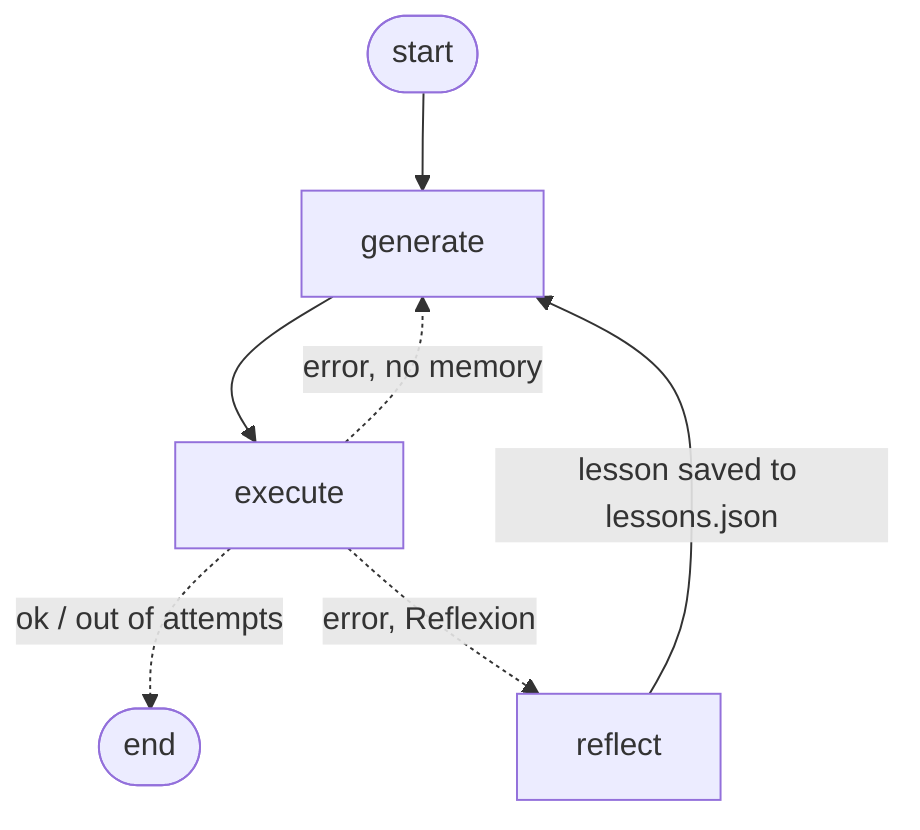

# Riyadh SQL Agent: Text-to-SQL with Reflexion (LangGraph)

Ask a business question in **English or Arabic** about a Riyadh food-delivery market dataset. The agent writes SQL and runs it read-only. When a query fails, it writes a short **lesson** about the mistake, stores it, and retries. Stored lessons are reused on later questions (the Reflexion pattern).

## Architecture



- **generate**: the LLM writes one SQLite query from the schema, any stored lessons, and the previous error.
- **execute**: runs the query in a read-only connection (`mode=ro`) and blocks anything that isn't a single SELECT/WITH. Errors and empty results are both counted as failures.
- **reflect**: the LLM turns the failure into one general lesson and saves it to `lessons.json`.

## Data

The Riyadh delivery market dataset (star schema): `customers` (300), `orders` (292), `dates` (768), `competitors` (30 POIs across HungerStation, Jahez, Marn and others). `data/` holds the audited, fixed version of this data (see the `Riyadh_Market_Project` repo for the full audit trail) — `is_late`, lat/lon, and `has_order_history` are all correct as of 2026-10-19.

## Results

The eval set is 20 questions (17 English, 3 Arabic), each with a known-correct SQL answer in `questions.json`. `python eval.py` writes `results.md`.

| Mode | Accuracy | Avg attempts | Time (s) |
|---|---|---|---|
| Baseline, llama3.2 (1 try, no lessons) | 11/20 (55%) | 1.00 | 92 |
| Reflexion, llama3.2 (3 tries + lessons) | 10/20 (50%) | 1.30 | 133 |
| Baseline, gemini-flash-lite-latest (1 try, no lessons) | 20/20 (100%) | 1.00 | 35 |
| Reflexion, gemini-flash-lite-latest (3 tries + lessons) | 20/20 (100%) | 1.00 | 105 |

llama3.2 (local, free, 3B) was the first backend tried — Reflexion actually
scored *worse* than a single try, likely too small a model to use its own
self-written lessons well. Gemini's free-tier `flash-lite` model gets
100% on both modes — no Reflexion retries needed on this eval set. The
default model is `gemini-flash-lite-latest`, not the newest `gemini-3.8-flash`
flagship: that one's free tier is capped at 20 requests/day (hit the wall
during testing), while `flash-lite` has a much higher free quota and was
just as accurate here.

## Run

```bash
python -m venv .venv && .venv\Scripts\activate   # Windows
pip install -r requirements.txt
copy .env.example .env
# edit .env: paste your free key from https://aistudio.google.com/app/apikey
python load_db.py                                # builds riyadh.db
python agent.py "Which district has the highest total order value?"
python agent.py "ما الحي الذي فيه أكبر عدد من الطلبات؟"
python eval.py                                   # baseline vs Reflexion
pytest -q                                        # safety tests
```

Backend is picked by `BACKEND` in `.env` — `gemini` (default, needs
`GOOGLE_API_KEY`) or `ollama` (fully local/free, needs `ollama pull llama3.2`
and `ollama serve` running). `MODEL` picks the specific model within
whichever backend. Default Gemini model is `gemini-flash-lite-latest`
(higher free-tier quota than the newest flagship model).

## Responsible AI

- Read-only at two levels: a SQL allow-list and a read-only database connection.
- The agent never changes data, and the safety tests prove it (`tests/test_guard.py`).
- Known limits: the scoring is lenient (extra columns in an answer are accepted), and the dataset is small. See `eval.py`.

## Stack

Python, LangGraph, LangChain (Gemini or local Ollama), SQLite, pytest.
